<div align="center">


# ELHAREEF — Book. Play. Win. ⚽

**The football pitch booking & matchmaking app for the Egyptian market.**
Book a pitch in seconds, post your match, and let nearby *hareefa* fill the empty spots.

[](https://flutter.dev)
[](https://dart.dev)
[](#-localization--rtl)
[](#)

</div>

---

## 📱 Screenshots

| Splash | Home | Search | Pitch details |
|:---:|:---:|:---:|:---:|
| 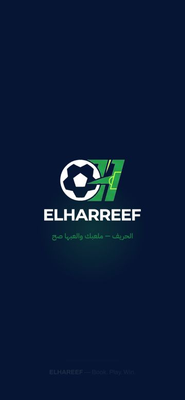 | 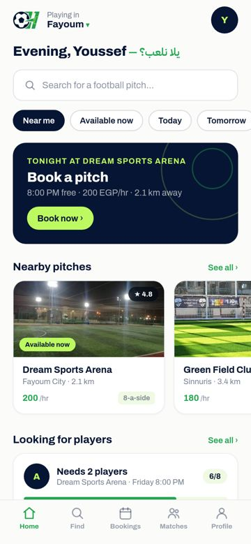 | 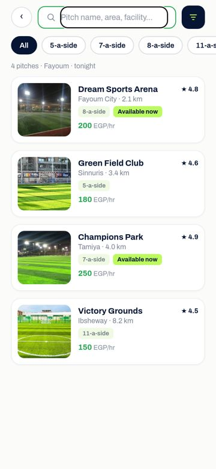 | 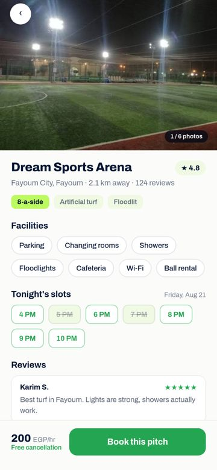 |

| Booking | Summary | Confirmed | Booking details |
|:---:|:---:|:---:|:---:|
| 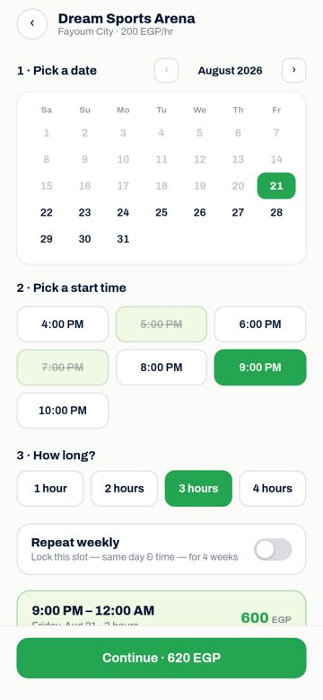 | 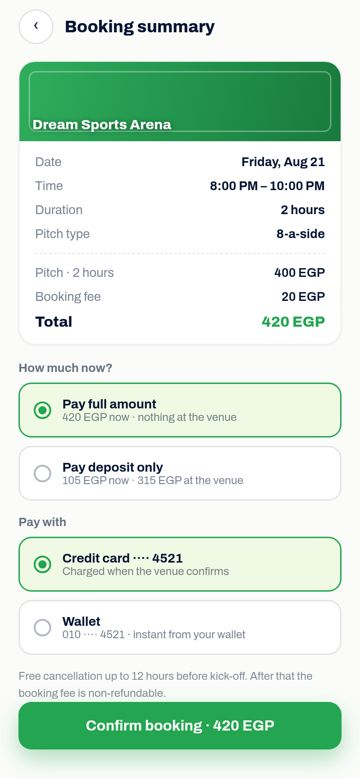 | 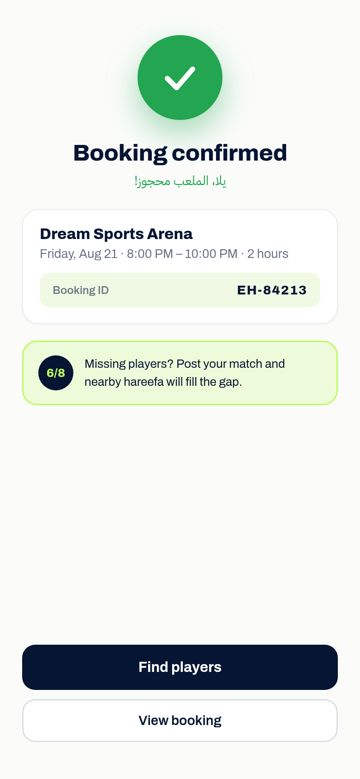 | 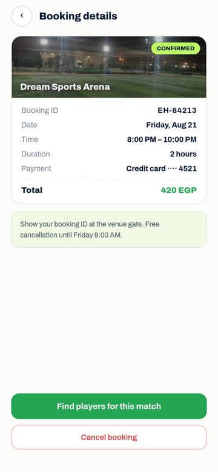 |

| Match discovery | Match details | Squad chat | Forgot password |
|:---:|:---:|:---:|:---:|
| 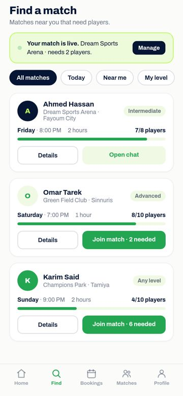 | 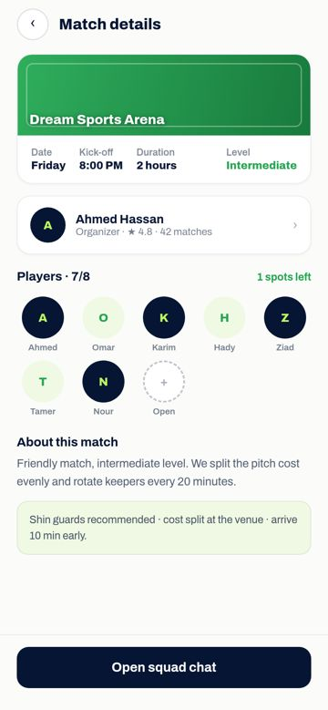 | 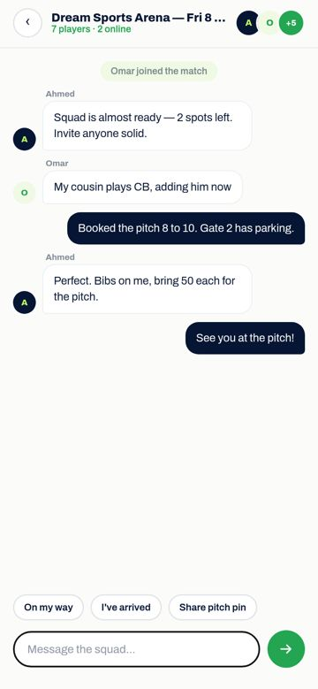 | 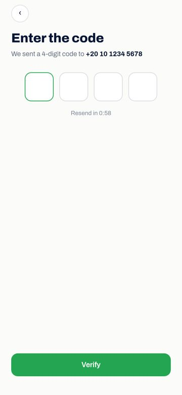 |

| Dark mode | العربية (RTL) |
|:---:|:---:|
| 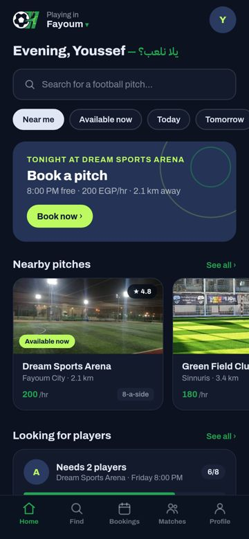 | 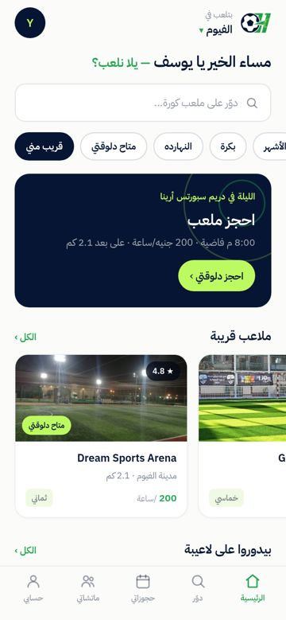 |

---

## ✨ Features

### 🏟️ Pitch booking
- Browse nearby pitches with real photos, ratings, prices, and live availability
- Search & filter by pitch type (5/7/8/11-a-side), price, and distance
- 3-step booking: **date → start time → duration** with live price calculation
- **Repeat weekly** — lock the same slot for 4 weeks with a deposit
- Pay in full or deposit-only · card or wallet · graceful payment-failure recovery

### 👥 Find players (matchmaking)
- Post your match — nearby players fill the empty spots
- Live capacity: joining a match updates `6/8 → 7/8` everywhere in real time
- Join lifecycle: request → pending → joined, with a **match-full** fallback state
- Player profiles with ratings, stats, and match history

### 💬 Squad chat
- Real-time-ready chat UI with sender/receiver bubbles, system events, and quick replies
- Structured so a WebSocket backend plugs in without touching the UI

### 🎨 Experience
- **Full Arabic (Egyptian) localization + RTL** — flips layout, fonts, and chevrons correctly
- **Dark mode** with a complete parallel token palette
- Smooth, finger-tracked **scroll-reveal** animations and soft selection cross-fades
- Loading skeletons, empty states, offline state, and friendly error recovery
- Secure auth screens: password with show/hide, validation, and a 3-step **forgot-password** flow (SMS code → new password)
## 🚀 Getting started

```bash
flutter pub get
flutter run                 # Android device/emulator (iOS needs macOS + Xcode)
flutter test                # logic tests + every-screen render test
flutter build apk --release # signed with the debug key until a keystore is set up
```

> **Requirements:** Flutter 3 (Dart SDK ^3.13).

---

## 🏗️ Architecture

```
lib/
├── main.dart      App entry, stack routes
├── scope.dart     App-wide providers (theme, i18n, stores) via InheritedNotifier
├── theme/         Design tokens — colors (light + dark), typography, spacing, radii
├── i18n/          Full EN/AR dictionary + RTL-aware translation helpers
├── types.dart     Domain models (Pitch, Match, BookingRecord, ChatMessage, …)
├── services/      Mock repositories with simulated latency & failure modes
│                  (pitches · matches · bookings · chat · players · network)
├── state/         ChangeNotifier stores — booking (selections + price math),
│                  matches (join lifecycle), chat (thread)
├── widgets/       Design-system primitives, icons, inputs, media, motion (anim.dart)
├── navigation/    Navigator helpers + bottom tabs
└── screens/       26 screens — every flow from splash to settings
```

**Design principles**

- **Single source of truth for tokens** — every color, radius, and font weight lives in `lib/theme/`.
- **UI ⇄ data separation** — screens only consume async service signatures. Swapping the mock bodies in `lib/services/` for real endpoints requires **no UI changes**.
- **No heavy state library** — three small stores on built-in `ChangeNotifier` (`context.watch<T>()` / `context.read<T>()`).

---

---

## 🧮 Business logic

| Rule | Implementation |
|---|---|
| Price | `duration × pitch rate × sessions` (+ 20 EGP booking fee) |
| Weekly repeat | 4 sessions, deposit locks all slots |
| Deposit | `max(50, 25% of total, rounded to 5 EGP)` |
| Slots | 4 PM – 10 PM, busy slots disabled with strikethrough |
| Join capacity | Server-confirmed; a full match returns `MatchFullError` → designed "match full" state |
| Payments | First card attempt declines (demo of the failure state); retry & cash-at-venue succeed |

---

## 🌍 Localization & RTL

The app ships with a complete **English / Egyptian-Arabic** dictionary (`lib/i18n/translations.dart`).
Switching to العربية from Settings flips — live, without a reload:

- Text, fonts (Archivo ↔ IBM Plex Sans Arabic), and alignment
- Row direction, tab order, and chevron mirroring (bidi-aware)
- Dates, prices, and pluralization (ساعة / ساعتين / ٣ ساعات)

---

## 🎨 Design system

| Token | Value |
|---|---|
| Pitch Navy | `#061533` |
| Turf Green | `#24A551` |
| Kick Lime | `#BDF961` |
| Pitch Tint | `#F0F9E4` |
| Cloud White | `#FBFCFA` |

Typography: **Archivo** (400–800) for UI · **IBM Plex Sans Arabic** (400/600) for Arabic.
Dark mode redefines the full palette (`lib/theme/colors.dart`) — no ad-hoc dark overrides.

---

## ⚠️ Known limitations

- **No backend** — all services return hard-coded data after a simulated delay (`lib/services/network.dart`), including the designed failure paths (first card payment declines, a match fills up, offline).
- **iOS** is configured (bundle id `com.elhareef.app`, icon, launch screen) but not yet built — requires macOS/Xcode.
- **Release signing** uses the debug key until a release keystore (`android/key.properties`) is configured.

---

## 🛣️ Roadmap

- [ ] Real backend (REST + WebSocket chat)
- [ ] Phone-number OTP authentication
- [ ] Payment gateway integration (card / mobile wallet)
- [ ] Push notifications (match reminders, join requests)
- [ ] Release keystore + Play Store listing
- [ ] Venue-owner dashboard

---

## 🧰 Tech stack

`Flutter 3` · `Dart 3` · `flutter_svg` · `flutter_localizations` · bundled Archivo & IBM Plex Sans Arabic fonts

---

<div align="center">

**ELHAREEF v1.0 · Made in Fayoum 🇪🇬**

</div>
